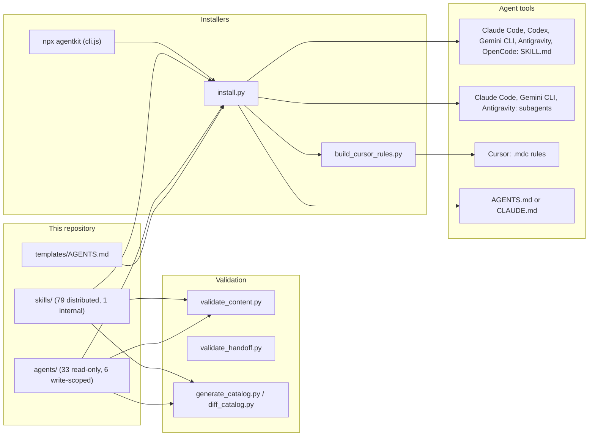

# Architecture

Generated by `python scripts/generate_mermaid_architecture.py`. See
`CATALOG.md` for every skill and subagent with its description.

## Distribution and validation

Internal skills apply only to this repository and are left out of the
`install` bundle; install one with `add <name>`.

## Subagent roles

Read-only subagents declare `Read, Grep, Glob, Bash` (research roles may add
web tools) and use Bash only for non-mutating commands. Write-scoped
subagents also declare `Edit` and `Write` and change only the paths the
parent assigns. Bash cannot be restricted through frontmatter, so these
limits are enforced by each subagent's instructions and the host's
permission settings.

```mermaid
flowchart TB
    subgraph ReadOnly [Read-only]
        R_accessibility_checker["accessibility-checker"]
        R_agent_orchestrator["agent-orchestrator"]
        R_api_compatibility_checker["api-compatibility-checker"]
        R_api_designer["api-designer"]
        R_ci_verifier["ci-verifier"]
        R_compliance_auditor["compliance-auditor"]
        R_concurrency_reviewer["concurrency-reviewer"]
        R_data_engineer["data-engineer"]
        R_database_architect["database-architect"]
        R_debugger["debugger"]
        R_dependency_auditor["dependency-auditor"]
        R_docs_researcher["docs-researcher"]
        R_ebpf_specialist["ebpf-specialist"]
        R_estimator["estimator"]
        R_explorer["explorer"]
        R_formal_verifier["formal-verifier"]
        R_frontend_reviewer["frontend-reviewer"]
        R_incident_commander["incident-commander"]
        R_infrastructure_reviewer["infrastructure-reviewer"]
        R_iot_embedded_auditor["iot-embedded-auditor"]
        R_llm_evaluator["llm-evaluator"]
        R_local_model_specialist["local-model-specialist"]
        R_migration_planner["migration-planner"]
        R_mobile_specialist["mobile-specialist"]
        R_performance_profiler["performance-profiler"]
        R_plan_reviewer["plan-reviewer"]
        R_release_engineer["release-engineer"]
        R_resilience_reviewer["resilience-reviewer"]
        R_reviewer["reviewer"]
        R_runbook_writer["runbook-writer"]
        R_security_reviewer["security-reviewer"]
        R_synthetic_data_architect["synthetic-data-architect"]
        R_verifier["verifier"]
    end
    subgraph WriteScoped [Write-scoped]
        W_backend_builder["backend-builder"]
        W_doc_writer["doc-writer"]
        W_frontend_builder["frontend-builder"]
        W_infra_builder["infra-builder"]
        W_mobile_builder["mobile-builder"]
        W_test_writer["test-writer"]
    end
```

| Role | Subagent | Responsibility |
| --- | --- | --- |
| write-scoped | `backend-builder` | Implements one bounded server-side slice (endpoint, handler, service, validation boundary, or backend test) against an agreed API contract, then returns verifiable evidence. |
| write-scoped | `doc-writer` | Writes or updates project documentation, including READMEs, tutorials, how-to guides, reference pages, API references, and architecture decision records, from code evidence, running or marking every command it documents. |
| write-scoped | `frontend-builder` | Implements one bounded web user-interface slice (component, page, form, or client data flow) in the project's existing web framework and design system, with tests. |
| write-scoped | `infra-builder` | Implements one bounded infrastructure-as-code or Kubernetes manifest change (Terraform, OpenTofu, Pulumi, CDK, Helm, or Kustomize) inside assigned paths, and returns the plan or rendered diff as evidence with every replace or destroy action called out. |
| write-scoped | `mobile-builder` | Implements one bounded mobile UI or client-data slice (screen, component, view model, local store, sync queue, permission flow, deep-link route, or notification handler) in the app's existing iOS, Android, React Native, Expo, or Flutter stack, with tests. |
| write-scoped | `test-writer` | Adds or repairs automated tests at public behavior seams for assigned behavior, including characterization tests before a refactor and regression tests for a fixed bug, and proves they fail and pass for the right reasons. |
| read-only | `accessibility-checker` | Audits UI markup, components, and styles against WCAG 2.2 Level AA (semantics, accessible names, keyboard and focus, contrast, target size, forms, and status messages) and maps each finding to a success criterion. |
| read-only | `agent-orchestrator` | Reviews multi-agent designs, orchestration code in any framework, and agent configuration (subagent definitions, AGENTS.md, CLAUDE.md) for unbounded loops, missing termination, over-broad tool permissions, context bloat, and prompt-injection boundaries. |
| read-only | `api-compatibility-checker` | Compares a library's or service's public API between two versions (git refs or published packages) and classifies each change as breaking, compatible, or behavioral-risk with path:line evidence, then recommends the SemVer bump and migration notes. |
| read-only | `api-designer` | Designs or reviews one bounded API contract (resources, operations, auth, typed requests and responses, errors, pagination, idempotency, versioning) from requirements and existing conventions, and returns an api-contract handoff. |
| read-only | `ci-verifier` | Diagnoses a CI run by tracing the run identity, job graph, and failing step, reproducing the exact command locally, and ranking causes with evidence. |
| read-only | `compliance-auditor` | Reviews code, configuration, and data flows for compliance readiness against GDPR, SOC 2, HIPAA, or PCI DSS: regulated-data inventory, redaction in logs and telemetry, encryption and key management, access control and tenant isolation, audit logging, and retention and erasure. |
| read-only | `concurrency-reviewer` | Reviews code changes for concurrency defects: check-then-act races, lost updates, transaction isolation assumptions, lock ordering and deadlocks, locks held across network calls, un-awaited or unbounded async work, shared mutable state, goroutine and task leaks, duplicate delivery, and non-idempotent retries, giving each finding a two-actor interleaving. |
| read-only | `data-engineer` | Reviews data pipelines and warehouse models (batch, streaming, ELT, dbt-style transformations) for grain, idempotent replay, incremental and late-data correctness, quality assertions, PII handling, and cost. |
| read-only | `database-architect` | Designs or reviews data models, schemas, keys, constraints, indexes, and access paths for a requested change, and returns the design part of a data-migration plan. |
| read-only | `debugger` | Investigates a bug, failing test, or regression by reproducing it, tracing the divergence, and testing competing hypotheses, then returns the root cause with evidence and no fix. |
| read-only | `dependency-auditor` | Audits dependencies from manifests and lockfiles for known vulnerabilities, reachability, license risk, staleness, and supply-chain signals without installing anything, and returns a dependency-audit report. |
| read-only | `docs-researcher` | Researches authoritative external documentation for the exact library, framework, SDK, or API versions a project uses, and returns version-tagged, cited facts to prevent hallucinated APIs. |
| read-only | `ebpf-specialist` | Reviews eBPF programs (XDP, tc, kprobe, tracepoint, fentry, LSM), their maps, and their loaders for verifier rejection risk, packet and pointer safety, kernel-version portability, and dangerous helper use, by static analysis only. |
| read-only | `estimator` | Sizes a proposed change by splitting it into slices, giving three-point PERT estimates as ranges with stated confidence, and anchoring them in similar past changes from the repository history. |
| read-only | `explorer` | Maps repository structure, entry points, dependencies, and data flows for a question or area. |
| read-only | `formal-verifier` | Reviews formal specifications and proofs (TLA+ with TLC or Apalache, Alloy, Dafny, SMT-LIB, Lean, Coq) and runs checkers within limits the parent sets, reporting counterexamples and exactly what was proven versus only model-checked. |
| read-only | `frontend-reviewer` | Reviews frontend components, state management, rendering boundaries, styling tokens, and bundle impact for correctness and performance risks. |
| read-only | `incident-commander` | Coordinates incident response: establishes impact and severity, keeps a UTC timeline that separates facts from hypotheses, assigns investigation, drafts communications, and proposes reversible mitigations with stop plans for the parent to authorize. |
| read-only | `infrastructure-reviewer` | Reviews Dockerfiles, Terraform and other infrastructure-as-code, Kubernetes and Helm manifests, and cloud configuration for security, reliability, and cost risks. |
| read-only | `iot-embedded-auditor` | Audits embedded firmware and RTOS code (FreeRTOS, Zephyr, ThreadX, bare metal) for interrupt-priority and ISR safety, task stacks and memory budgets, watchdog design, DMA and cache coherence, driver robustness, and OTA signing, anti-rollback, and fallback, by static analysis only. |
| read-only | `llm-evaluator` | Reviews LLM evaluation designs, datasets, graders, and results for whether they support the decision: success criteria, judge calibration, variance and confidence intervals, contamination, personal data sent to third-party APIs, and cost. |
| read-only | `local-model-specialist` | Reviews whether an open-weight model can run locally as planned: weight and KV-cache memory math, usable GPU or unified memory, quantization tradeoffs, engine choice among Ollama, llama.cpp, and vLLM, server configuration, and streaming time to first token. |
| read-only | `migration-planner` | Plans rollout, backward compatibility, and rollback for schema, data, API, and configuration migrations, and audits migration files for lock hazards, deploy-ordering breaks, and unsafe rollbacks. |
| read-only | `mobile-specialist` | Audits iOS, Android, React Native, Expo, and Flutter release configuration (manifests, privacy manifests, permissions, signing, versioning, shrinking and symbols, OTA channels, and staged rollout readiness) for store rejection and release risk. |
| read-only | `performance-profiler` | Measures one performance target against a reproducible baseline with approved local profiling on non-production targets, then reports bottlenecks with evidence and the next experiment. |
| read-only | `plan-reviewer` | Critiques an implementation plan against the actual codebase for missing steps, wrong assumptions, unhandled risks, scope creep, and unverifiable acceptance criteria, and proposes concrete amendments. |
| read-only | `release-engineer` | Audits release readiness for a commit range: SemVer bump correctness, changelog completeness against Keep a Changelog, migration steps for breaking changes, manifest and artifact versions, and rollback readiness. |
| read-only | `resilience-reviewer` | Reviews failure handling across service, database, queue, cache, and provider boundaries: timeouts, retries and backoff, idempotency, circuit breakers, pools, queues, rate limits, fallbacks, graceful shutdown, and recovery paths. |
| read-only | `reviewer` | Reviews a diff, branch, or pull request for correctness, security, error handling, performance, and test coverage, verifying each finding before reporting it. |
| read-only | `runbook-writer` | Drafts an operational runbook for one service and failure mode from repository evidence: detection, diagnosis, mitigation, recovery, escalation, and rollback limits, with every step labeled by verification status. |
| read-only | `security-reviewer` | Reviews a bounded change, endpoint, or integration for exploitable security flaws in authentication, authorization, input handling, secrets, tenant isolation, and LLM or agent features such as prompt injection and over-broad tool permissions. |
| read-only | `synthetic-data-architect` | Designs referentially intact, PII-free, reproducible synthetic data plans from a schema: insertion order over the foreign-key graph with cycle handling, volumes and skewed distributions, constraint-safe field rules, and seeding determinism. |
| read-only | `verifier` | Verifies completed work against its acceptance criteria by running each of the project's declared lint, type-check, build, and test commands separately and tracing every criterion to evidence. |
